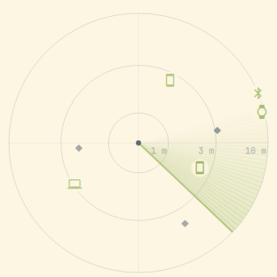

# Omarchy Bluetooth Radar

A little radar for your [Omarchy](https://omarchy.org) bar. Open it and the
Bluetooth devices and Wi-Fi networks around you show up as icons — watches,
phones, earbuds, laptops, TVs, trackers — closer ones nearer the centre.

<p align="center">
  
</p>

> **Omarchy only.** This is a plugin for the Omarchy shell (Quickshell bar on
> Arch + Hyprland). It won't run on other desktops or distros.

## What it does

- **See what's around** — every device as its own icon, with a rough distance
  and an arrow when it is getting closer (`↓`) or moving away (`↑`).
- **Know what things are** — reads what devices announce: AirPods model and
  battery, Windows laptop vs desktop, Galaxy Watch, Samsung TVs, thermometers
  (Xiaomi, Govee, Ruuvi, BTHome) and their readings.
- **Find a lost device** — pick it and walk hot/cold with a big meter (and
  optional Geiger clicks) until you're on top of it.
- **Guard** — optional alerts when a tracker that's away from its owner
  (AirTag, SmartTag, Tile…) keeps following you, or camera glasses
  (Ray-Ban/Oakley Meta…) come close.
- **Proximity lock** — optional: lock the screen when the watch or phone you
  carry walks away from the laptop. It only ever locks, never unlocks.
- **Tidy Wi-Fi list** — repeaters and hidden companion networks folded into
  one router.

It only **listens**: it never connects to anything, never saves what it hears,
and puts Bluetooth back exactly how it found it (even when Omarchy turned it
off).

## Install

```bash
omarchy plugin add https://github.com/MarDevMint/omarchy-bluetooth-radar
omarchy plugin enable m.radar
```

Left-click the radar icon in the bar to open it, right-click to start or stop
scanning. Want a key for it?

```lua
o.bind("SUPER + ALT + R", "Radar", "omarchy-shell shell toggle m.radar '{}'")
```

## Keys

| Key | |
| --- | --- |
| `S` | start / stop scanning |
| `↑` `↓` | pick a device (or click its icon) |
| `L` | find the picked device · `M` sound on/off |
| `F` | only show devices within 10 m / 3 m / all |
| `U` | hide devices it can't identify |
| `W` · `B` | Wi-Fi networks · classic Bluetooth |
| `⇧C` · `⇧R` | calibrate distance with the device 1 m away · reset |
| `⇧G` | Guard on/off |
| `⇧K` | proximity lock on the picked device |
| `Esc` | back / close |

Keys that change something lasting need Shift, so a stray keystroke can't arm
a lock.

## Good to know

- **Distances are rough.** Signal strength gives "about 3 m", not "3.2 m".
- **Direction isn't real.** One antenna can't tell where a signal comes from;
  each device just keeps a fixed spot on the circle.
- **Connected devices go quiet.** A watch paired to its phone barely
  advertises — to find yours, switch the phone's Bluetooth off first.
- **No alert doesn't mean nothing's there.** Camera glasses mostly announce
  themselves when switched on or pairing.

Everything else — settings, how the signal filtering works, IPC commands,
privacy details — is in the [full guide](docs/GUIDE.md).

## Requirements

A stock Omarchy install already has what it needs: BlueZ, NetworkManager and
Python 3 with `python-dbus` and `python-gobject`. No root, no extra packages.

## Privacy

Device addresses are replaced by salted hashes inside the scanner and never
reach the shell. Nothing is written to disk except your own settings (and, if
you use proximity lock, a hash of that one device). Please use it as a
curiosity and for your own safety — not to follow people.

## License

MIT — see [LICENSE](LICENSE).
